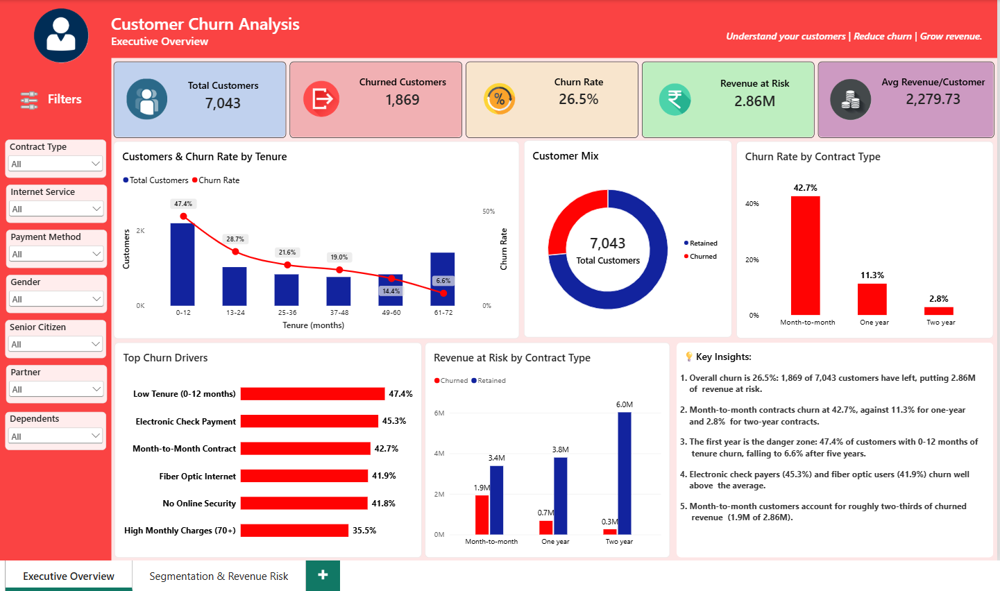
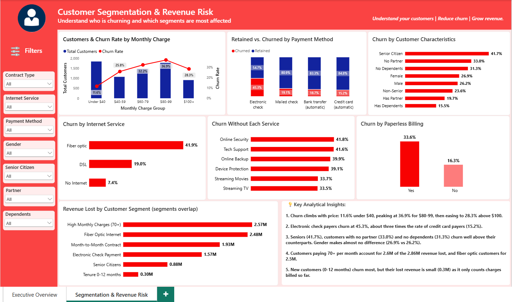

# Customer Churn Analysis Dashboard (Power BI)

A two-page Power BI dashboard that shows how many customers a telecom company is losing, which customer segments churn the most, and how much revenue is lost. It is built on top of my earlier [Customer Churn Analysis using PostgreSQL](#) project (add the link to your SQL repository).

## Dashboard Preview

| Page 1: Executive Overview | Page 2: Segmentation & Revenue Risk |
|---|---|
|  |  |

## Business Problem

Customer churn directly reduces recurring revenue, and acquiring a new customer costs more than keeping one. This dashboard answers three questions:

1. How big is the churn problem, and how much revenue does it put at risk?
2. Which customer segments, services and billing choices are linked to the highest churn?
3. Where should a retention team focus first?

## Dataset

- **Source:** IBM Telco Customer Churn (Kaggle)
- **Size:** 7,043 customers, 21 columns
- **Storage:** PostgreSQL database `customer_churn_db`, table `customers`, connected to Power BI directly
- **Fields used:** contract type, internet service, payment method, tenure, monthly and total charges, paperless billing, add-on services, gender, senior citizen, partner, dependents, churn status

## Tools

PostgreSQL, Power BI Desktop, DAX

## Dashboard Structure

### Page 1: Executive Overview
- KPI cards: Total Customers, Churned Customers, Churn Rate, Revenue at Risk, Average Revenue per Customer
- Customers & Churn Rate by Tenure (combo chart)
- Customer Mix (retained vs. churned donut)
- Churn Rate by Contract Type
- Top Churn Drivers
- Revenue at Risk by Contract Type
- Key Insights

### Page 2: Segmentation & Revenue Risk
- Customers & Churn Rate by Monthly Charge (combo chart)
- Retained vs. Churned by Payment Method (100% stacked column)
- Churn by Customer Characteristics (gender, senior citizen, partner, dependents)
- Churn by Internet Service
- Churn Without Each Service (online security, tech support, online backup, device protection, streaming)
- Churn by Paperless Billing
- Revenue Lost by Customer Segment
- Key Analytical Insights

Seven synced slicers (Contract Type, Internet Service, Payment Method, Gender, Senior Citizen, Partner, Dependents) filter both pages.

## Key Findings

- **Overall churn is 26.5%**: 1,869 of 7,043 customers have left, putting **2.86M** of revenue at risk.
- **Contract type is the strongest signal:** month-to-month contracts churn at **42.7%**, against 11.3% for one-year and 2.8% for two-year contracts.
- **The first year is the danger zone:** 47.4% of customers with 0-12 months of tenure churn, falling to 6.6% for those with 61-72 months.
- **Price:** churn rises from 11.6% for charges under $40 to a peak of **36.9% for $80-99**, then eases to 28.3% above $100.
- **Payment method:** electronic check payers churn at **45.3%**, about three times the rate of credit card payers (15.2%).
- **Customer profile:** senior citizens (41.7%), customers without a partner (33.0%) and without dependents (31.3%) churn well above their counterparts. Gender makes almost no difference (26.9% vs 26.2%).
- **Services:** customers without online security (41.8%) or tech support (41.6%) churn the most. Fiber optic customers churn at 41.9%.
- **Where the revenue is lost:** customers paying 70+ per month account for about 2.6M of the 2.86M lost revenue, and fiber optic customers for about 2.5M.

## Suggested Actions

- Offer retention deals or contract upgrades to month-to-month customers, especially in the first year.
- Encourage electronic check customers to move to automatic payments.
- Review pricing and service quality for high-charge fiber optic customers.
- Promote online security and tech support add-ons to customers who don't have them.

## Data Model and DAX

**Measures:** Total Customers, Churned Customers, Churn Rate, Retained Customers, Retention Rate, Revenue at Risk, Total Revenue, Churned Revenue %, Average Revenue per Customer, and others.

```DAX
Churn Rate =
DIVIDE([Churned Customers], [Total Customers], 0)

Revenue at Risk =
CALCULATE(SUM(Customers[total_charges]), Customers[churn] = "Yes")
```

**Calculated columns:** `Churn Status`, `Tenure Group`, `Monthly Charge Group`, `Monthly Charge Order`, `Senior Citizen Status`, `Internet Service Type`.

**Helper tables:** small disconnected tables (`Churn Drivers`, `Customer Segments`, `Service Types`, `Revenue Segments`) combined with a `SWITCH` measure, to put segments from different columns on one chart axis. For example:

```DAX
Driver Churn Rate =
VAR _driver = SELECTEDVALUE('Churn Drivers'[Driver])
RETURN
SWITCH(
    _driver,
    "Month-to-Month Contract", CALCULATE([Churn Rate], Customers[contract] = "Month-to-month"),
    "Low Tenure (0-12 months)", CALCULATE([Churn Rate], Customers[tenure] <= 12),
    BLANK()
)
```

## Design Notes and Limitations

- The dataset has **no date column**, so there is no monthly trend. Tenure groups are used to show how churn changes over the customer lifecycle.
- **Revenue at Risk** is the total charges billed to churned customers so far. It understates the future loss for new customers, who have paid little yet.
- Segments on the "Revenue Lost by Customer Segment" and "Top Churn Drivers" charts **overlap**, so their bars are not additive.
- The text in the Key Insights panels is static and reflects the full dataset. It does not change with slicers.
- Colour logic: **red = churn**, **navy = retained customers or customer volume**.

## How to Use

1. Download `Customer_Churn_Dashboard.pbix` and open it in Power BI Desktop.
2. If you want to refresh the data, update the PostgreSQL connection to your own `customers` table.
3. Use the slicers in the left sidebar to filter by segment.

## Author

Soumyadip Sinha Roy
